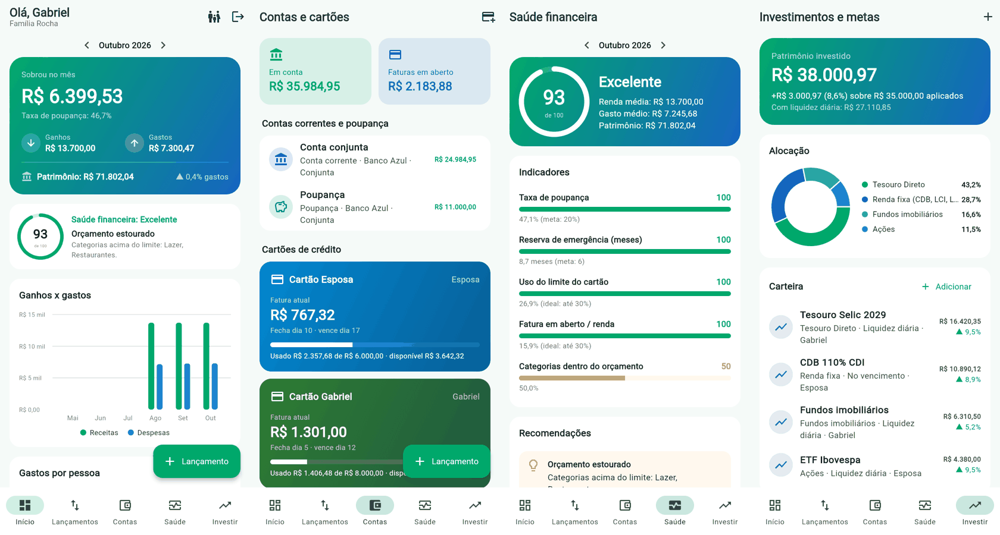

<h1 align="center">Family Funds</h1>

<p align="center">
  <strong>O controle financeiro da sua família, em um app feito para usar em casa.</strong><br>
  Quanto a família ganha, quanto gasta, quem gastou, como está o cartão e se a saúde financeira vai bem.
</p>

<p align="center">
  <a href="https://github.com/gabriel1305rocha/FamilyFunds/actions/workflows/ci.yml"></a>
  <a href="https://github.com/gabriel1305rocha/FamilyFunds/actions/workflows/codeql.yml"></a>
  
  
  
</p>

<p align="center">
  
</p>

## Funcionalidades

- **Ganhos x gastos:** resumo do mês com taxa de poupança, gráfico dos últimos 6 meses e gastos por categoria.
- **A família toda:** cada membro (você, sua esposa, os filhos) tem seus lançamentos, contas e cartões. O painel mostra quem ganhou e quem gastou quanto.
- **Conta corrente e cartão de crédito:** saldo das contas, fatura atual pelo dia de fechamento, limite usado e disponível, compras parceladas e pagamento de fatura como transferência.
- **Orçamento:** limite mensal por categoria, com alerta quando estoura.
- **Saúde financeira de 0 a 100:** combina taxa de poupança, reserva de emergência, uso do limite do cartão, peso da fatura na renda e orçamento, com recomendações práticas.
- **Investimentos e metas:** carteira com alocação, rentabilidade e liquidez, insights (reserva antes de renda variável, diversificação, exposição a cripto) e metas com o valor a guardar por mês.
- **Privado por padrão:** seus dados ficam no seu servidor. Cada família só enxerga os próprios dados.

## Como funciona

```
app/       App Flutter (Android, iOS e web) — Material 3 em verde e azul
backend/   API REST — Node.js 22, Express 5, PostgreSQL 16, JWT, validação com zod
docs/      Imagens e documentação
```

O app conversa com a API, e a API guarda tudo no PostgreSQL. Para uso em casa, a API e o banco rodam juntos via Docker em qualquer computador sempre ligado (mini PC, NAS, Raspberry Pi ou um servidor na nuvem).

## Começando

### Pré-requisitos

- [Docker](https://docs.docker.com/get-docker/) (ou PostgreSQL 16+ instalado)
- [Node.js](https://nodejs.org/) 22+
- [Flutter](https://docs.flutter.dev/get-started/install) 3.47+ (canal stable)

### Desenvolvimento

```bash
# 1. Banco de dados
docker compose up -d postgres

# 2. API
cd backend
cp .env.example .env
npm install
npm run migrate          # cria as tabelas
npm run seed             # opcional: família demo (demo@familyfunds.app / familia123)
npm run dev              # http://localhost:3000

# 3. App (em outro terminal)
cd app
flutter pub get
flutter run -d chrome                                         # web
flutter run --dart-define=API_URL=http://10.0.2.2:3000/api   # emulador Android
```

### Uso em casa (API + banco com Docker)

```bash
# Na raiz do projeto, crie um .env com um segredo forte (pelo menos 32 caracteres):
echo "JWT_SECRET=$(openssl rand -hex 32)" > .env
echo "POSTGRES_PASSWORD=$(openssl rand -hex 16)" >> .env
# Só se for usar o app web: o endereço onde ele estará publicado
echo "CORS_ORIGIN=http://192.168.0.10:8080" >> .env

docker compose --profile full up -d --build
```

Depois, gere o app apontando para o endereço do servidor, por exemplo:

```bash
flutter build apk --dart-define=API_URL=http://192.168.0.10:3000/api
```

> Para acessar fora de casa, coloque a API atrás de HTTPS (Caddy, Nginx ou um túnel como Tailscale/Cloudflare Tunnel). Veja [SECURITY.md](SECURITY.md).

## Testes e qualidade

| Onde | Comando |
|---|---|
| API | `npm run lint`, `npm run format:check`, `npm test` (usa o banco `familyfunds_test`) |
| App | `dart format --set-exit-if-changed lib test`, `flutter analyze`, `flutter test` |

O GitHub Actions roda tudo isso em cada pull request, além de compilar o app web e a imagem Docker da API. O CodeQL faz análise de segurança, e o Dependabot mantém as dependências atualizadas.

## API

Todas as rotas ficam em `/api` e, exceto as de autenticação, exigem `Authorization: Bearer <token>`.

| Recurso | Rotas |
|---|---|
| Autenticação | `POST /auth/register`, `POST /auth/login`, `GET /auth/me` |
| Membros | `GET/POST /members`, `PATCH/DELETE /members/:id` |
| Contas e cartões | `GET/POST /accounts`, `GET/PATCH/DELETE /accounts/:id` (saldo, limite usado, fatura atual) |
| Categorias | `GET/POST /categories`, `PATCH/DELETE /categories/:id` |
| Lançamentos | `GET /transactions?month=&type=&member_id=&account_id=&category_id=&search=`, `POST` (aceita `installments`), `PATCH`, `DELETE ?scope=all` |
| Orçamentos | `GET/POST /budgets`, `PATCH/DELETE /budgets/:id` |
| Investimentos e metas | `/investments`, `/goals` (CRUD) |
| Relatórios | `GET /reports/summary`, `/reports/cashflow`, `/reports/health`, `/reports/investments`, `/reports/dashboard` |
| Saúde do serviço | `GET /health` (fora de `/api`, verifica o banco) |

## Roadmap

- [ ] Importar extratos bancários (OFX/CSV)
- [ ] Lançamentos recorrentes (aluguel, assinaturas, salário)
- [ ] Atividades da família: viagens, eventos e objetivos compartilhados
- [ ] Notificações de vencimento de fatura e orçamento estourado
- [ ] Exportar relatórios em PDF/planilha

## Contribuindo

Veja [CONTRIBUTING.md](CONTRIBUTING.md). Para relatar uma vulnerabilidade, siga o [SECURITY.md](SECURITY.md).

## Licença

Uso pessoal e não comercial. Veja [LICENSE](LICENSE).
